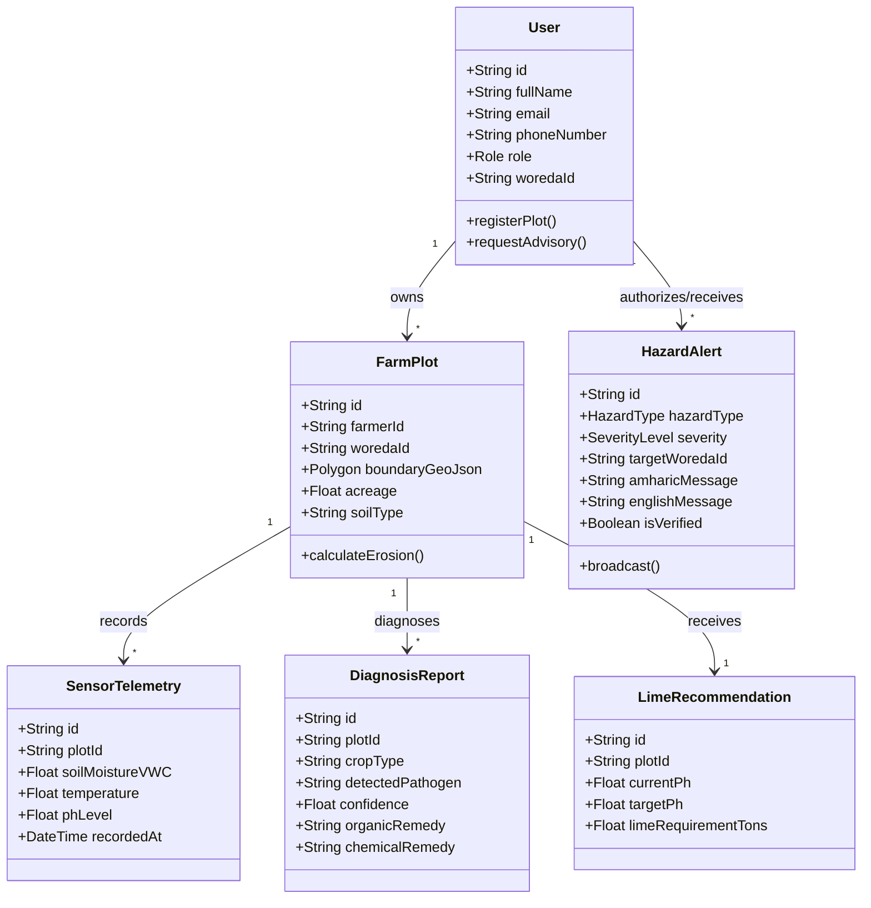

# EthioFarm

### Sovereign Multi-Hazard Agricultural Early Warning & Planetary Intelligence System

<div align="center">

[](https://github.com/agrietech)
[-1B8A44?style=flat-square)](https://en.wikipedia.org/wiki/Ethiopia)
[-22C55E?style=flat-square)](https://github.com/agrietech/agriEtech-backend)
[](https://github.com/agrietech/agriEtech-frontend)
[-22C55E?style=flat-square)](https://github.com/agrietech/ethiofarm-web)

</div>

---

## Demonstration & Download

[](PASTE_VIDEO_DEMO_LINK_HERE)

[](https://drive.google.com/file/d/1y71KTIHfFaIaEqArmZm9yI5O4IOSx0Ys/view?usp=sharing)

---

## Table of Contents

1. [Introduction](#introduction)
2. [Statement of Problem](#statement-of-problem)
3. [Objectives (Solutions)](#objectives-solutions)
4. [Key Features](#key-features)
5. [Actors](#actors)
6. [Limitations](#limitations)
7. [Methodology](#methodology)
8. [Functional Requirements](#functional-requirements)
9. [Non-Functional Requirements](#non-functional-requirements)
10. [Testing and Evaluation Used](#testing-and-evaluation-used)
11. [Class Diagram](#class-diagram)
12. [Technologies Used](#technologies-used)
13. [UI](#ui)
14. [Unique Features](#unique-features)
15. [Conclusion](#conclusion)

---

## Repositories & Team Information

The platform is maintained across three core repositories within the [`agrietech`](https://github.com/agrietech) organization:

| Repository | System Domain & Architectural Scope | Core Technology Stack | Continuous Integration Status |
| :--- | :--- | :--- | :---: |
| **[`agriEtech-backend`](https://github.com/agrietech/agriEtech-backend)** | Central REST/WebSocket Gateway, Spatial RBAC, Satellite Pipelines & Hazard Modeling | Node.js 18+ LTS, Express, PostGIS, Prisma, Redis, BullMQ | 34 Suites / 226 Tests Passed |
| **[`agriEtech-frontend`](https://github.com/agrietech/agriEtech-frontend)** | Offline-First Cross-Platform Client for Smallholders & Extension Agents | Flutter 3.x, Dart 3.x, Riverpod 2.x, GoRouter, Material 3 | 207 Tests Passed |
| **[`ethiofarm-web`](https://github.com/agrietech/ethiofarm-web)** | Enterprise GIS Operations Center for District, Zonal & Regional Directorates | React 18.3, TypeScript 5.6, Vite 6, Tailwind CSS | Clean Production Compilation |

### Team Members

| Contributor Full Name | Institutional CTC ID | Engineering Role | Delivered Subsystems & Core Architectures |
| :--- | :---: | :--- | :--- |
| **Abraham Amogne** | `CTC-3291-26` | Team Leader, Platform Architect & Full-Stack Engineer | Distributed system architecture, Express PostGIS gateway, satellite data pipelines, RUSLE soil model, Joyner-Boore seismology, multi-channel notification engine, and Flutter client foundation. |
| **Alen Biruk** | `CTC-2176-26` | Geospatial Operations & IoT  | Parcel polygon registry, OCHA administrative boundary integration, IoT soil sensor telemetry, and volumetric water content gauges. |
| **Zinegnaw Kebede** | `CTC-514-26` | Computer Vision & Pathology  | Interactive browser webcam viewfinder, multi-step leaf disease classification, localized remedy cards, and diagnosis history log explorer. |
| **Banchamlak Golla** | `CTC-2952-26` | Agro-Meteorology & Alerts | Hyper-local weather telemetry, 24-hour temperature curves, multi-hazard early warning cards, and livestock herd registry. |

---

## Introduction

**EthioFarm** is a sovereign multi-hazard agricultural disaster intelligence, farm parcel registry, and emergency broadcast ecosystem engineered specifically for Ethiopia's agricultural territory ($3.2^\circ\text{N} - 15.2^\circ\text{N}, 32.8^\circ\text{E} - 48.2^\circ\text{E}$). The platform establishes an operational data bridge between smallholder farming households, frontline Kebele Development Agents (DAs), Woreda agricultural offices, Zonal/Regional directorates, and national scientific research bodies.

The platform continuously synthesizes planetary remote sensing, in-situ capacitive soil probe telemetry, numerical seismological attenuation equations, and empirical pedological algorithms to deliver preemptive interventions before irreversible crop damage occurs. The architecture unifies an enterprise Node.js PostGIS backend engine, a Flutter cross-platform mobile application, and a React TypeScript web command portal, backed by multi-channel telecommunications across USSD (`*212#`), character-budgeted SMS, and regional voice synthesis.

| 18M+ | 1.1M km² | 16 Agro-Ecologies | 7 Institutional Tiers | 3 Core Platforms |
| :---: | :---: | :---: | :---: | :---: |
| Smallholders Addressed | Sovereign Monitoring Area | Calibrated Soil Profiles | Gated Escalation Levels | Backend · Mobile · Web |

---

## Statement of Problem

In Ethiopia, digital early warning and precision agriculture address acute structural vulnerabilities across national food systems:

```
┌──────────────────────────────────────────────────────────────────────────────────────────────────┐
│                                   STRUCTURAL SYSTEMIC CRISES                                     │
├───────────────────────────────┬───────────────────────────────┬──────────────────────────────────┤
│   MICRO-PARCEL FRAGMENTATION  │  OBSERVATION SENSOR DEFICIT   │     SOIL EROSION & ACIDITY       │
│  • 80% rainfed subsistence    • Vast 1.1M km² topography      • 42–130 t/ha/yr topsoil loss      │
│  • 33% GDP / 75% export value • <1 station per 5,000 km²      • $1.06B annual economic damage    │
│  • Average parcel < 0.9 ha    • Complex cloud occlusion       • 43% highland soils acidic        │
├───────────────────────────────┼───────────────────────────────┼──────────────────────────────────┤
│    TECTONIC & HYDROLOGICAL    │     CONNECTIVITY INCLUSION    │    INSTITUTIONAL INFORMATION GAP │
│  • Main Ethiopian Rift faults • 70%+ rural coverage on 2G     • Unmoderated alerts trigger panic │
│  • Irrigation dam vulnerability• Feature phone reliance       • Cognitive overload on producers  │
│  • River basin flood surges   • Low English literacy          • 60,000 extension agents bypassed │
└───────────────────────────────┴───────────────────────────────┴──────────────────────────────────┘
```

1. **Severe Smallholder Micro-Parcel Fragmentation**: Over 18 million smallholder households cultivate average fragmented holdings below **0.9 hectares**, leaving families with zero financial reserves during seasonal climate shocks, locust invasions, or localized blights.
2. **Surface Meteorological Observation Deficit**: Automatic weather stations are sparsely distributed across Ethiopia's 1.1 million km² mountainous territory (averaging $< 1\text{ station per } 5,000\text{ km}^2$), necessitating satellite remote sensing as the only economically and mathematically viable mechanism for continuous agro-climatological monitoring.
3. **Highland Edaphic Acidity & Topsoil Depletion**: Water erosion strips up to **130 metric tons/ha/year** of fertile topsoil. Furthermore, **43% of arable highland soils** (predominantly Dystric Nitisols) suffer from severe chemical acidity ($pH < 5.2$), triggering aluminum ($Al^{3+}$) trivalent ion toxicity and irreversibly locking bioavailable orthophosphate.
4. **Main Ethiopian Rift Tectonic & Hydrological Hazards**: The East African Rift transects vulnerable earth-fill irrigation retaining structures (e.g., Koka, Tendaho, Kesem dams) and earthen canals, while major river basins (Awash, Omo-Gibe, Abbay) face periodic flash flood surges.
5. **Rural Telecommunications Infrastructure Constraints**: Over 70% of producers operate basic 2G feature phones without English literacy. Modern smartphone-only, broadband-dependent platforms fail to reach frontline agricultural producers.
6. **Institutional Information Governance Gap**: Unmoderated, unverified hazard alerts broadcast directly to farmers trigger premature harvesting, localized market crashes, and cognitive overload. Ethiopia's 60,000+ frontline extension agents remain systematically bypassed in the information chain.

---

## Objectives (Solutions)

EthioFarm resolves these structural crises through five primary technical objectives:

### 1. Planetary Multi-Spectral Remote Sensing
* Ingests Copernicus Sentinel-2 MSI multispectral reflectance ($NDVI, NDRE, EVI, SAVI$), Sentinel-1 synthetic aperture radar (SAR) C-band backscatter for soil moisture estimation, and Landsat 8/9 Thermal Infrared Sensors (TIRS).
* Evaluates CHIRPS Standardized Precipitation Index values over a 3-month window (SPI-3) to forecast meteorological drought onset months before visible vegetative stress occurs.

### 2. Pedological Soil Acidity & Erosion Remediation
* Evaluates annual topsoil degradation using the Revised Universal Soil Loss Equation (RUSLE) calibrated across 16 distinct Ethiopian agro-ecological profiles:
  $$A = R \times K \times LS \times C \times P \quad (\text{t/ha/year})$$
* Executes automated stoichiometric Agricultural Lime (ኖራ / $CaCO_3$) neutralization equations, computing exact metric tonnage requirements per parcel to eliminate aluminum toxicity and restore optimal pH levels ($6.0 - 6.8$).

### 3. Joyner-Boore Structural Seismology & Basin Hydrology
* Computes Peak Ground Acceleration ($PGA$) and Modified Mercalli Intensity ($MMI$) from seismic feeds using Joyner-Boore ground-motion attenuation equations:
  $$\ln(PGA) = c_1 + c_2 M - \ln\sqrt{d^2 + h^2} + c_3 \sqrt{d^2 + h^2}$$
  to assess structural integrity of irrigation canals and earthen dams across the Main Ethiopian Rift.
* Models hydrographic runoff discharge curves ($m^3/s$) across major drainage basins to compute return-period inundation alerts ($Q_2, Q_5, Q_{20}$).

### 4. Multimodal Deep Edge Crop Pathology
* Deploys Google Gemini Vision models and deep botanical taxonomy classifiers for real-time leaf image triage, cross-referenced with deterministic offline diagnostic matrices for localized agronomic remedies.

### 5. Multi-Channel Telecommunications Inclusion
* Implements an interactive USSD gateway (`*212#`) compliant with Africa's Talking protocols, a character-budgeted SMS engine optimizing GSM-7 versus UCS-2 byte limits for Amharic script, and regional voice synthesis (Amharic, Afaan Oromoo, Tigrinya).

---

## Key Features

* **Georeferenced Polygon Parcel Registry**: Validates GPS farm boundaries against sovereign Ethiopian spatial coordinates ($3.2^\circ\text{N} - 15.2^\circ\text{N}, 32.8^\circ\text{E} - 48.2^\circ\text{E}$) with acreage and woreda indexing.
* **IoT Soil Sensor Telemetry Fleet**: Real-time telemetry tracking volumetric water content ($\theta_v$), soil temperature, and electrical conductivity.
* **Spatial Administrative Hazard Command Center**: Interactive choropleths rendering OCHA HDX administrative Woreda polygons with dynamic composite risk scores.
* **Browser-Native Pathology Camera Viewfinder**: Client-side video frame capture via HTML5 `MediaDevices` with automated canvas downscaling ($\le 1\text{MB}$) for low-latency diagnostic inference.
* **Localized Pharmacopeia & Treatment Cards**: Structured pathology cards delivering chemical IPM protocols and biological remedies translated into regional Ethiopian languages.
* **Interactive USSD Dialing Emulator (`*212#`)**: On-device interactive dialer simulator validating session state transitions for offline feature phone workflows.
* **Dual-Alphabet SMS Byte Budgeter**: Automated character budgeting supporting GSM-7 (160 characters) and UCS-2 (70 characters for Ethiopic script) to eliminate multi-segment carrier surcharges.

---

## Actors

The platform explicitly models 7 institutional actors corresponding to the administrative hierarchy of the Ethiopian agricultural extension system:

| Actor | Institutional Scope | Core Operational Responsibilities | Dedicated Interface |
| :--- | :--- | :--- | :--- |
| **Smallholder Farmer** | Household Parcel | Ground truth telemetry generator; receives binary operational directives on irrigation, pathology, and frost alerts. | Mobile App & USSD `*212#` |
| **Development Agent (DA)** | Kebele FTC | Validates AI disease triage; registers parcel polygons; oversees neighborhood soil sensor probe clusters. | Mobile App & FTC Workbench |
| **Woreda Desk Officer** | District Command | Authorizes emergency SMS broadcasts; models hydrological runoff; allocates district fertilizer and lime quotas. | Enterprise Web Portal |
| **Zonal Directorate** | Multi-Woreda | Oversees cross-boundary river basins; coordinates emergency equipment and seed reserve reallocation. | Enterprise Web Portal |
| **Regional Bureau** | Macro-Region | Tracks macro-trends in satellite vegetation indices ($VCI$); coordinates with national disaster risk agencies (EDRMC). | Enterprise Web Portal |
| **Agronomy Researcher** | National Institutes | Accesses raw multi-spectral satellite reflectance; calibrates computational agronomic models against field yield outcomes. | Enterprise Web Portal |
| **National Administrator** | Federal Ministry | Manages system IAM, approves role escalations, audits security logs, and enforces national data sovereignty. | Enterprise Web Portal |

---

## Limitations

* **Atmospheric Optical Occlusion**: Cloud-cover during the *Kiremt* monsoon season impairs optical Sentinel-2 reflectance; mitigated by Sentinel-1 synthetic aperture radar (SAR) backscatter penetration.
* **Carrier Network Delivery Latency**: SMS delivery across rural 2G Kebeles is subject to telecommunication gateway congestion; mitigated by real-time USSD callback sessions.
* **Hardware GPS Drift**: Low-cost mobile handset GPS chips exhibit 3–5 meter drift; mitigated by Kebele Development Agent manual parcel polygon confirmation.
* **Baseline Soil Sampling Requirements**: Accurate lime dosage requires initial soil pH calibration, which must be recorded through Farmers Training Center (FTC) ground testing.

---

## Methodology

The platform engineering followed an **Agile Domain-Driven Design (DDD)** methodology with continuous integration:

1. **Clean Architecture Separation**: Strict decoupling into Presentation, Application, Domain, and Infrastructure tiers to guarantee testability and database agnosticism.
2. **Empirical Parameterization**: Mathematical engines (RUSLE, Lime stoichiometry, Joyner-Boore) were parameterized using peer-reviewed pedological and geophysical data for Ethiopia.
3. **Defensive Resilience Engineering**: All cloud connectors incorporate deterministic offline baseline fallbacks to ensure uninterrupted local operation during network partition events.
4. **Test-Driven Verification**: Quality gates enforce 100% test passing across unit, integration, and widget suites before production deployment.

---

## Functional Requirements

* **FR1 (Parcel Georeferencing)**: The system shall capture, validate, and persist farm plot boundary polygons within Ethiopian sovereign geographic boundaries.
* **FR2 (Telemetry Ingestion)**: The system shall ingest real-time volumetric soil moisture, temperature, and electrical conductivity from physical or synthetic IoT probes.
* **FR3 (Hazard Modeling)**: The system shall compute RUSLE soil erosion rates, stoichiometric lime requirements, and Joyner-Boore seismic ground acceleration.
* **FR4 (Crop Pathology Triage)**: The system shall analyze uploaded leaf photography, identify pathogens with confidence scoring, and output localized chemical/organic remedies.
* **FR5 (Multi-Channel Dispatch)**: The system shall broadcast validated hazard alerts via SMS (GSM-7/UCS-2) and USSD callbacks.
* **FR6 (Role-Based Access Control)**: The system shall restrict alert broadcast authority and spatial data access according to institutional role hierarchy.

---

## Non-Functional Requirements

* **NFR1 (Performance)**: API gateway spatial query latency shall resolve in $< 200\text{ ms}$ under nominal operating load.
* **NFR2 (Security)**: All endpoints shall enforce JWT bearer authentication with spatial geographic bounding validation and rate limiting.
* **NFR3 (Scalability)**: Background notification dispatch and satellite ingestion tasks shall be decoupled using Redis BullMQ worker queues.
* **NFR4 (Usability & Accessibility)**: Web interfaces shall comply with WCAG 2.1 AA standards; mobile interfaces shall support low-bandwidth offline caching.
* **NFR5 (Reliability)**: The core platform shall provide local deterministic decision matrix fallbacks in the event of external cloud API failure.

---

## Testing and Evaluation Used

| Subsystem | Metric | Verified Status | Execution Command |
| :--- | :--- | :---: | :--- |
| **Backend Service Engine** | Static Code Analysis | **0 Errors, 0 Warnings** | `npm run lint` |
| **Backend Service Engine** | Unit & Integration Test Suites | **34 Suites, 226 Tests Passed** | `npm test` |
| **Backend Service Engine** | Service Smoke Checks | **19 of 19 Passed (100%)** | `npm run test:smoke` |
| **Mobile Cross-Platform Client** | Dart Typed Static Analysis | **0 Issues Found** | `flutter analyze` |
| **Mobile Cross-Platform Client** | Automated Unit & Widget Tests | **207 of 207 Tests Passed** | `flutter test` |
| **Enterprise Web Portal** | TypeScript Production Build | **0 Compiler Errors (Clean Bundle)** | `npm run build` |
| **Enterprise Web Portal** | Accessibility Standards | **WCAG 2.1 AA Compliant ($\ge 4.5:1$)** | Verified across themes |

---

## Class Diagram

```text
┌─────────────────────────────────────────────────────────────────────────────────────────────────┐
│                                 ETHIOFARM PLATFORM ARCHITECTURE                                 │
├───────────────────────────────┬───────────────────────────────┬─────────────────────────────────┤
│        NATIVE MOBILE          │        ENTERPRISE WEB         │       LAST-MILE COMMUNICATIONS  │
│         Flutter Client        │       React Web Portal        │        USSD · SMS · Voice AI    │
│    (Android, iOS, Tablets)    │    (Command Centers & GIS)    │    (2G Feature Phones & FTC)    │
└───────────────┬───────────────┴───────────────┬───────────────┴─────────────────┬───────────────┘
                │                               │                                 │
                ▼                               ▼                                 ▼
┌─────────────────────────────────────────────────────────────────────────────────────────────────┐
│                                 REST & WEBSOCKET API GATEWAY                                    │
│                     Node.js LTS · Express · Helmet · Rate Limiter · BullMQ                      │
├─────────────────────────────────────────────────────────────────────────────────────────────────┤
│                     DECENTRALIZED AGRO-INSTITUTIONAL GOVERNANCE ENGINE                          │
│     Farmer ➔ Kebele DA ➔ Woreda Desk ➔ Zonal Directorate ➔ Regional Bureau ➔ Research ➔ Admin    │
├─────────────────────────────────────────────────────────────────────────────────────────────────┤
│                             COMPUTATIONAL HAZARD & AI ENGINES                                   │
│  ┌─────────────────────────┐  ┌─────────────────────────┐  ┌─────────────────────────────────┐  │
│  │ Remote Sensing Pipeline │  │ Seismology (USGS PGA)   │  │ RUSLE Soil Erosion Engine       │  │
│  │ Sentinel-1/2, Landsat   │  │ Joyner-Boore Equations  │  │ Calibrated Soil Profiles        │  │
│  ├─────────────────────────┤  ├─────────────────────────┤  ├─────────────────────────────────┤  │
│  │ Hydrology (River Basins)│  │ Drought Modeling        │  │ Crop Pathology Vision AI        │  │
│  │ Discharge & Runoff      │  │ CHIRPS Precipitation    │  │ Taxonomic Diagnostics           │  │
│  └─────────────────────────┘  └─────────────────────────┘  └─────────────────────────────────┘  │
├─────────────────────────────────────────────────────────────────────────────────────────────────┤
│                                 DATA & SPATIAL PERSISTENCE                                      │
│                  PostgreSQL + PostGIS (GeoJSON) · Prisma ORM · Redis Cache                      │
└─────────────────────────────────────────────────────────────────────────────────────────────────┘
```



---

## Technologies Used

| Architectural Tier | Selected Technologies |
| :--- | :--- |
| **Enterprise Web** | React 18.3, TypeScript 5.6, Vite 6, Tailwind CSS, Lucide Icons, Axios Interceptors |
| **Cross-Platform Mobile** | Flutter 3.x, Dart 3.x, Riverpod 2.x, GoRouter, Material 3 Design Tokens |
| **API Gateway & Core** | Node.js 18+ LTS, Express 4, Prisma ORM, Helmet, Express Rate Limit, BullMQ |
| **Spatial Persistence & Cache** | PostgreSQL 15, PostGIS 3.3 (GeoJSON, Spatial Indexing), Redis 7 (Distributed Cache & Queues) |
| **Planetary Remote Sensing & AI** | Copernicus Sentinel-2 MSI, Sentinel-1 SAR, Landsat 8/9 TIRS, CHIRPS SPI-3, Google Gemini Vision |
| **Telecommunications Gateway** | Africa's Talking USSD Protocol, GSM-7 / UCS-2 SMS Byte Budgeter, Web Audio Synthesis |
| **Verification & Quality** | Jest (34 Suites / 226 Tests), Flutter Test (207 Tests), ESLint, TypeScript Compiler |

---

## UI

The user interface implements a role-adaptive architecture tailored to diverse hardware and bandwidth capabilities:

* **Enterprise Geospatial Operations Command Center (`ethiofarm-web`)**:
  * Scaffolding built with React 18.3, TypeScript 5.6, and Tailwind CSS.
  * Geospatial cartographic overlays rendering OCHA HDX administrative boundaries with dynamic choropleth classification.
  * Real-time volumetric water gauges (`SensorGauge`) featuring animated SVG dials and Volumetric Water Content ($\theta_v\%$) thresholds.
  * Camera viewfinder interface (`CameraViewfinder`) leveraging HTML5 `MediaDevices.getUserMedia` for client-side canvas capture and auto-downscaling.
  * Comprehensive design tokenization supporting dark and light themes with WCAG 2.1 AA compliant contrast ratios ($\ge 4.5:1$).
* **Cross-Platform Field Client (`agriEtech-frontend`)**:
  * Flutter 3.x with Riverpod 2.x declarative reactive architecture and Material Design 3 tokens.
  * Role-adaptive dashboards presenting simplified binary guidance to farmers while providing full telemetry to extension agents.
  * Low-vision accessibility supporting dynamic typography scaling up to 1.5x with Ethiopic font baseline optimizations.
  * Interactive on-device USSD `*212#` dialer simulator enabling complete offline advisory validation without carrier contracts.

---

## Unique Features

* **Sovereign Agricultural Lime Dosage Algorithm**: Replaces generic fertilizer recommendations with calibrated stoichiometric lime tonnage calculations based on specific Ethiopian highland edaphic profiles.
* **Rift Valley Seismic Dam Attenuation**: Tailored Joyner-Boore PGA curves directly evaluating structural vulnerability of earth-fill dams and irrigation canals in the East African Rift.
* **7-Tier Anti-Panic Institutional Governance**: Prevents premature harvesting and localized market crashes by enforcing an administrative validation gate before public alert broadcasts.
* **Deterministic Offline Decision Matrices**: Guaranteed localized diagnostic capability even during complete cloud connectivity severed events.
* **Ethiopic Protocol-Level Byte Optimization**: Native dual-alphabet character budgeting engineered specifically for Ge'ez/Amharic Unicode script transmissions over cellular networks.

---

## Getting Started

### System Prerequisites
* **Node.js**: `v18.x LTS` or higher
* **Database**: `PostgreSQL 15+` with `PostGIS 3.3+`
* **Distributed Cache**: `Redis 7.x`
* **Mobile Runtime**: `Flutter 3.22+` & `Dart 3.4+`

### Local Execution Workflow

```bash
# 1. Clone all ecosystem repositories
git clone https://github.com/agrietech/agriEtech-backend.git
git clone https://github.com/agrietech/agriEtech-frontend.git
git clone https://github.com/agrietech/ethiofarm-web.git

# 2. Launch Backend Service Engine
cd agriEtech-backend
npm install
npx prisma db push
npm run dev

# 3. Launch Cross-Platform Mobile Client
cd ../agriEtech-frontend
flutter pub get
flutter run

# 4. Launch Enterprise Web Portal
cd ../ethiofarm-web
npm install
npm run dev
```

---

## Conclusion

EthioFarm constitutes a production-verified, sovereign engineering response to Ethiopia's multi-hazard agricultural crisis. The platform's distinguishing contributions — calibrated RUSLE soil erosion modeling, Joyner-Boore seismic attenuation for irrigation infrastructure, stoichiometric highland lime dosage algorithms, and a seven-tier anti-panic institutional governance engine — are grounded in peer-reviewed Ethiopian pedological and geophysical data, not generic global models. By unifying satellite earth observation, offline-resilient cross-platform mobile applications, an enterprise GIS web command center, and last-mile USSD/SMS/voice telecommunications, EthioFarm operationalizes data sovereignty: delivering actionable, language-appropriate intelligence to 18 million smallholder households while enforcing a structured escalation chain from Kebele Development Agent to Federal Ministry.

---

<div align="center">
<sub>EthioFarm Sovereign Planetary Intelligence System · Organization: <a href="https://github.com/agrietech">agrietech</a></sub>
</div>
